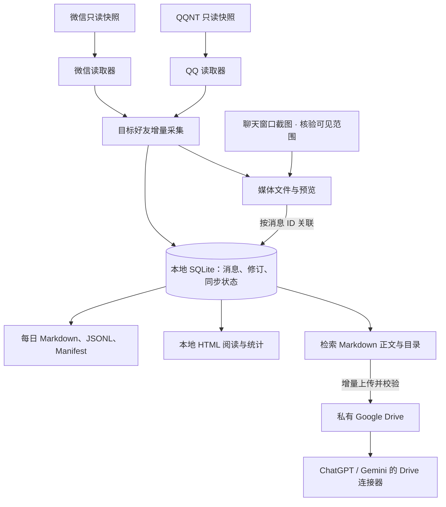

# ChatTrace

ChatTrace 在 Windows 上归档指定好友的微信或 QQ 私聊。每个平台使用独立配置、本地归档和私有 Drive 目录。已验证 Windows x64、Python 3.12、微信 4.1.15.56 和 QQNT 9.9.36.53644。

原始文字、发送者、时间和来源 ID 保存到 SQLite。图片和表情按内容哈希保存。每日导出包含 Markdown、JSONL、Manifest 和修订历史。月度 HTML 用于人工浏览；面向 Drive 连接器的文档按连续聊天和话题组织，每条已入库消息在正式检索正文中出现一次。截图使用 Windows Graphics Capture，保留真实聊天画面，需要可用的桌面窗口和范围核对。

## 架构

手动执行 `update` 和北京时间 04:00 的计划任务共用同一条流程。下图展示默认发布路径。每次运行只使用当前配置指定的平台和好友，微信与 QQ 各自维护独立的 SQLite 状态库、资源目录和 Drive 发布记录。



启用 LLM 时，构建器把聊天片段交给配置的模型生成话题边界和导航信息；关闭后使用本地规则。两种方式都从归档消息生成检索正文。

## 开始使用

在 Windows PowerShell 中获取源码：

```powershell
git clone https://github.com/hellokiaqi/ChatTrace.git
cd ChatTrace
```

1. 按 [安装与首次配置](docs/setup.md) 创建虚拟环境，确认好友身份，完成本地试读与 Drive 授权。
2. 微信使用默认配置 `config.json`。QQ 请按 [QQ 配置与实测范围](docs/qq.md) 绑定账号和好友。
3. 在项目目录执行对应的更新命令。完成首次配置后，手动运行和 Windows 计划任务均可独立完成采集、构建和发布。

| 平台 | 立即更新 | 注册每日北京时间 04:00 任务 |
|---|---|---|
| 微信 | `.\run.ps1 update` | `.\run.ps1 schedule install` |
| QQ | `.\run.ps1 --config config.qq.local.json update` | `.\run.ps1 --config config.qq.local.json schedule install` |

在配置项 `archive_root` 指向的目录内，打开 `v4/human/index.html` 阅读聊天，打开 `v4/human/statistics.html` 查看统计。任务暂停、恢复及故障处理见 [运行手册](docs/operations.md)。

| 入口 | 用途 |
|---|---|
| `update` | 手动和定时共用的完整更新 |
| `run --no-upload` | 仅采集和生成每日归档 |
| `run --backfill --no-upload` | 补采指定好友电脑端全部可读消息 |
| `build --preview`、`validate --preview`、`promote` | 独立预览、核验和发布本地检索卷 |
| `sync --dry-run`、`sync` | 查看 Drive 计划或只同步已构建的正式检索卷 |
| `status`、`coverage`、`pending` | 检查本地采集记录、覆盖情况及文件上传队列 |
| `stats` | 生成本地统计页，按北京时间选择日、周、月或自定义区间 |

手动同步与每天 04:00 的更新都在 Drive 的 `01_Retrieval_Markdown` 中发布 UTF-8 Markdown 文件。打开 `01_CATALOG.md` 可跳转到各卷聊天原文。

[检索文档与目录结构](docs/retrieval.md) · [聊天统计口径](docs/statistics.md) · [人工导入格式](docs/input.md) · [发布验证](docs/verification.md)

## 数据与第三方组件

`private/`、`config.json`、`oauth/`、`secrets/` 和 `.env` 属于部署数据。SQLite、消息、媒体、截图、密钥及真实测试材料均不随 Git 源码发布。本地明文归档依赖 Windows 账户及磁盘保护。启用语义分段时，所配置的模型供应商会收到聊天窗口原文。离线构建可使用 `build --no-llm`。

微信适配器仅对已核实的客户端版本开放。它使用已登录用户权限读取账号密钥、联系人和消息快照。明文数据库在内存中查询。引用的上游源码、许可证和修改说明见 [第三方声明](chattrace/vendor/NOTICE.md)。
